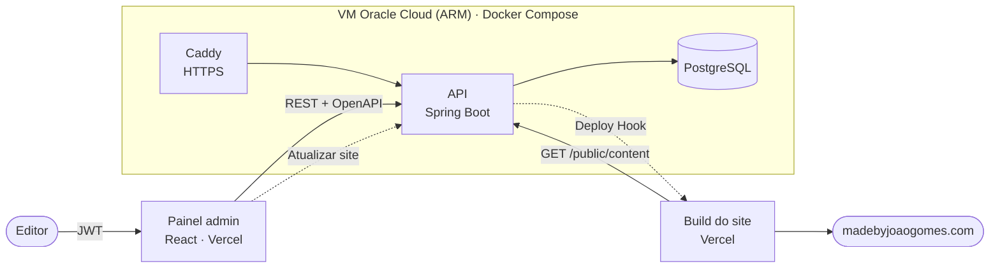

# portfolio-platform

[](https://github.com/joaosamuelgomes/portfolio-platform/actions/workflows/ci.yml)
[](https://sonarcloud.io/summary/new_code?id=joaosamuelgomes_portfolio-platform)
[](https://sonarcloud.io/summary/new_code?id=joaosamuelgomes_portfolio-platform)
[](https://sonarcloud.io/summary/new_code?id=joaosamuelgomes_portfolio-platform)

A plataforma de conteúdo por trás de [madebyjoaogomes.com](https://madebyjoaogomes.com): uma **API em Java e Spring Boot** e um **painel administrativo em React**, em produção na Oracle Cloud com deploy contínuo.

O site é estático, rápido e bom para SEO, mas os cases e artigos ficavam presos no código: cada mudança de texto pedia um commit. Esta plataforma separa as duas coisas. O conteúdo é editado no painel e guardado na API, e o site lê o que está publicado no momento do build. O site continua estático; só a origem do conteúdo mudou.

## Em produção

| | |
| --- | --- |
| Site | [madebyjoaogomes.com](https://madebyjoaogomes.com), repositório [joaosamuelgomes/portfolio](https://github.com/joaosamuelgomes/portfolio) |
| API e documentação | [api.madebyjoaogomes.com/swagger-ui](https://api.madebyjoaogomes.com/swagger-ui/index.html) |
| Painel | [admin.madebyjoaogomes.com](https://admin.madebyjoaogomes.com), com uma conta de demonstração somente leitura disponível sob pedido |
| Qualidade | [SonarCloud](https://sonarcloud.io/summary/overall?id=joaosamuelgomes_portfolio-platform) |
| Design system do site | [Storybook](https://joaosamuelgomes.github.io/portfolio/) |

## Arquitetura



1. O editor entra no painel e escreve ou publica projetos e artigos. A API valida e guarda tudo no PostgreSQL.
2. O botão **"Atualizar site"** pede um novo build na Vercel. Um lote de edições vira um build só, e nada sai pela metade.
3. No build, o site lê `GET /public/content`, que traz só o que está publicado, e gera as páginas estáticas. Se a API não responder, o build falha e o site no ar continua intacto ([ADR 0004](docs/adr/0004-site-le-a-api-no-build.md)).

## Stack

| Camada | Tecnologias |
| --- | --- |
| API | Java 21, Spring Boot 3.5, Spring Security (JWT), Spring Data JPA, PostgreSQL 16, Flyway, Bean Validation, springdoc-openapi, Actuator |
| Painel | React 19, TypeScript, Vite, Tailwind CSS 4, TanStack Query, React Hook Form, openapi-typescript + openapi-fetch |
| Testes | JUnit 5, Mockito, Testcontainers (PostgreSQL real), JaCoCo, Vitest, Testing Library |
| Infraestrutura | Docker, Docker Compose, Caddy, Oracle Cloud (VM ARM, Object Storage), Vercel |
| CI/CD e qualidade | GitHub Actions, GHCR, SonarCloud, Dependabot, GitGuardian |

## Destaques técnicos

**Contrato tipado de ponta a ponta.** O contrato OpenAPI é gerado do código da API, e o cliente TypeScript do painel é gerado desse contrato. Se a API mudar um campo, o painel deixa de compilar antes de chegar à produção. Os erros seguem a RFC 9457 (`application/problem+json`), e o painel mapeia cada erro de validação para o campo certo do formulário.

**Segurança:**
- **Autenticação:** JWT stateless com dois perfis. `ADMIN` escreve; `VIEWER` só lê, e é a conta de demonstração para recrutadores ([ADR 0002](docs/adr/0002-autenticacao-jwt-stateless.md)). Rotas não mapeadas são negadas por padrão.
- **Login:** depois de 10 falhas em 15 minutos, o mesmo endereço recebe `429` antes de a senha ser checada, o que poupa CPU com o bcrypt.
- **Entradas:** validação do esquema das URLs de imagem, sanitização do Markdown no painel, CSP e headers de segurança.
- **Repositório:** os segredos ficam só no ambiente, nunca no código. Secret scanning e bloqueio de push estão ativos. O projeto passou por uma auditoria de segurança completa antes de virar público.

**Testes e qualidade:**
- **Banco real nos testes:** os testes de integração rodam contra um PostgreSQL de verdade (Testcontainers), com a cadeia de segurança inteira ligada.
- **Análise:** o SonarCloud analisa API e painel em todo PR, com a cobertura do JaCoCo e do Vitest, e o quality gate aparece como checagem no PR.
- **Dependências:** o Dependabot propõe as atualizações minor e patch; versões major viram migração planejada.

**Entrega contínua.** Cada push na `main` faz o seguinte:
1. testa a API e o painel;
2. gera a imagem ARM com buildx (o Maven roda nativo, e só o estágio final passa por emulação);
3. publica a imagem no GHCR;
4. faz o deploy na VM por SSH, com uma chave dedicada e a chave do servidor fixada;
5. confere o health check.

A VM não guarda credencial do GitHub: o token só passa por ela durante o `docker pull`.

**Operação com custo zero:**
- **Hospedagem:** tudo roda no Always Free da Oracle Cloud, com um budget de R$ 1/mês e alerta.
- **Backup:** `pg_dump` diário enviado para o Object Storage por uma URL que só permite escrita. A VM consegue enviar backups, mas não lê, não lista nem apaga os que já estão lá. Uma regra de retenção impede sobrescrever os recentes ([ADR 0005](docs/adr/0005-api-numa-vm-always-free.md)).

## Decisões de arquitetura

| ADR | Decisão |
| --- | --- |
| [0001](docs/adr/0001-blocos-do-projeto-em-jsonb.md) | Colunas relacionais para o que é consultado, JSONB para os blocos de apresentação do case |
| [0002](docs/adr/0002-autenticacao-jwt-stateless.md) | JWT stateless emitido pela própria API, com perfis ADMIN e VIEWER |
| [0003](docs/adr/0003-formato-do-snapshot.md) | O snapshot público segue o formato dos arquivos de origem do site |
| [0004](docs/adr/0004-site-le-a-api-no-build.md) | O site lê a API no build, e a publicação é um pedido explícito |
| [0005](docs/adr/0005-api-numa-vm-always-free.md) | API e banco numa VM Always Free, com deploy pela CI e backup externo |

## Estrutura do repositório

| Pasta | Conteúdo |
| --- | --- |
| [`api/`](api/README.md) | API Spring Boot: domínio, segurança, migrações e testes |
| [`admin/`](admin/README.md) | Painel React com o cliente gerado do OpenAPI |
| [`deploy/`](deploy/README.md) | Produção: Docker Compose, Caddy, backup e operação da VM |
| [`scripts/`](api/README.md#importando-o-conteúdo-do-site) | Importação do conteúdo original do site para a API, preservando os ids |
| [`docs/adr/`](docs/adr) | Registros de decisões de arquitetura |

## Rodando localmente

Com Java 21 e Docker:

```bash
cp .env.example .env    # preencha JWT_SECRET e as senhas
docker compose up --build
```

A API sobe em `localhost:8080`, com o Swagger em `/swagger-ui/index.html`. Os detalhes de cada parte, incluindo o painel e a importação do conteúdo, estão nos READMEs de [`api/`](api/README.md), [`admin/`](admin/README.md) e [`deploy/`](deploy/README.md).
